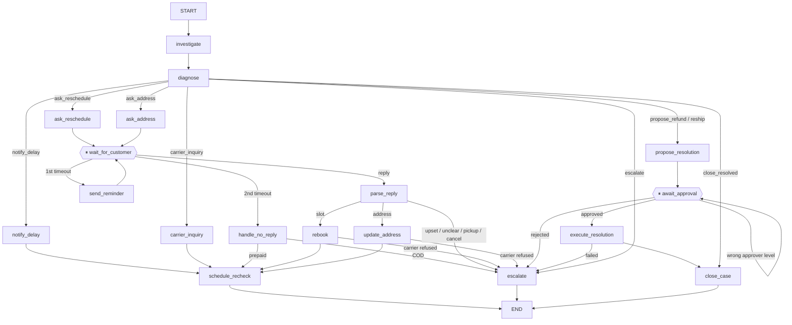
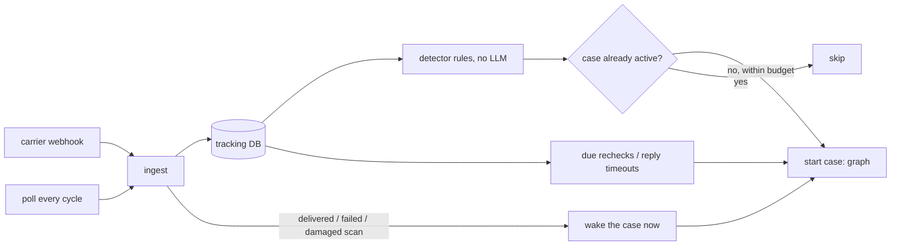

# DeliveryFix
DeliveryFix is an AI agent that catches delivery problems before customers do. It monitors shipments, investigates delays and failed deliveries via carrier APIs, notifies customers, and rebooks or escalates automatically. Built with LangChain, LangGraph and LangSmith, it handles routine cases end to end and asks staff to approve refunds.

## Roadmap

| Phase | Scope | Status |
|---|---|---|
| 0 | Tracking layer: normalized carrier statuses, mock carriers, tracking DB | Done (mock carriers) |
| 1 | LangChain layer: tools, schemas, policy RAG, guardrails, LLM chains | Done |
| 2 | Core LangGraph flow: investigate → diagnose → route → act, checkpointing | Done |
| 3 | Waits and humans: customer-reply webhooks, `interrupt()` approvals, timeouts | Done |
| 4 | Detection and scale: rule-based scanner, case dedupe, retries, rate limits | Done |
| 5 | LangSmith: tracing, evaluation dataset, monitoring | Planned |

## Layout

```
shipment_agent/
  schemas.py        Pydantic models: tracking, orders, Diagnosis, CustomerReplyParse
  config.py         Hard limits (refund caps, confidence threshold), enforced in code
  scenarios.py      8 seed shipments, one per exception type, with expected diagnoses
  carriers/
    base.py         CarrierAdapter interface (swap in Shiprocket/AfterShip later)
    status_map.py   Raw carrier status -> NormalizedStatus; logs unmapped codes
    mock.py         Mock Delhivery / Blue Dart with capabilities and simulated failures
    resilient.py    Retries with backoff for reads, no blind retries for actions, rate limits
  stores.py         Order store (PII masked for the LLM), case history, refunds/reships/tickets
  messaging.py      Approved templates only, idempotent per case
  policy/
    policies.md     Company policy, one section per chunk with metadata
    retriever.py    BM25 retriever with carrier/topic filters
  tools.py          ReadTools (LLM-callable) and ActionTools (graph nodes only)
  guardrails.py     Deterministic overrides applied to every Diagnosis
  prompts.py        Investigator, diagnoser and reply-parser prompts
  chains.py         Investigation tool loop, diagnoser, reply parser
  graph/
    state.py        CaseState: one thread per shipment, append-only actions/log
    brain.py        LLMBrain (real chains) and ScriptedBrain (deterministic, no API key)
    nodes.py        investigate, diagnose (+ guardrails), action nodes, router
    topology.py     The graph's shape, defined once
    build.py        Compiles the LangGraph StateGraph with a checkpointer
    simulate.py     Same topology in plain Python, including interrupt/resume
    persist.py      Persistent checkpointer (LangGraph SqliteSaver) / thread store (simulator)
  service.py        Entry points: inbound replies, approvals, timeouts, carrier events, starts
  tracking_db.py    SQLite: shipments, scan events, case registry
  ingest.py         Carrier webhooks and polling into the tracking DB
  detector.py       Rule-based exception flags (no LLM)
  scheduler.py      Monitor: one cycle = poll, timeouts, detect, start, rechecks
tests/
demo.py             Runs the read tools on all scenarios; --llm adds diagnosis
run_graph.py        Runs every scenario through the case graph
run_monitor.py      Simulates three days of the monitor: cycles, replies, webhooks, an outage
```

## The case graph



**Phase 2: the core flow**

- **One thread per shipment** (`thread_id = shipment:<AWB>`), so a recheck
  re-enters the same case with its history, recheck count and earlier actions.
- **Rechecks** are re-invocations of the thread with `trigger="recheck"`. After
  `max_rechecks` (3) without resolution, the case escalates instead of sending
  more messages.
- **Guardrails run inside `diagnose`**, and both the raw LLM diagnosis and the
  final one are kept in state for evaluation.

**Phase 3: waiting on people (`interrupt()`)**

- **Customer replies.** After asking for a slot or an address, the case pauses
  in `wait_for_customer`. `CaseService.handle_inbound_message(phone, text)` (what a
  WhatsApp/SMS/email webhook calls) finds the case and resumes it. The reply is
  parsed into a `CustomerReplyParse`; a valid slot is rebooked, a valid address is
  sent to the carrier, and the customer gets a confirmation.
- **Replies that need a person**: upset or ambiguous replies, low parser
  confidence, pickup or cancel requests, slots in the past or more than 7 days out,
  and carriers that refuse an address change (Blue Dart: needs RTO). The ticket
  quotes the customer's words.
- **Timeouts.** Each question has a 24h deadline. `fire_due_timeouts()` (run by a
  scheduler) resumes overdue cases: the first timeout sends one reminder and waits
  again; the second escalates COD orders and leaves prepaid ones to the carrier's
  own reattempt, per policy.
- **Approvals.** Refund and reship proposals pause in `await_approval`.
  `pending_approvals()` lists them with evidence and policy refs; `decide(...)`
  resumes. Above ₹5,000 an agent's approval is rejected and the case keeps waiting
  for a manager. Approved proposals are executed with the approver's name recorded,
  the customer is told, and the case closes. Rejections escalate with the note.
- **Safe re-runs.** LangGraph re-runs a node from the top when it resumes, so the
  waiting nodes have no side effects before `interrupt()`; questions and reminders
  are sent by the node before, and messaging is idempotent.

**Phase 4: detection and scale**



- **The LLM only sees flagged shipments.** `detector.py` applies plain rules to the
  tracking DB (damaged, failed attempt, unknown status, customs hold, no scan for 48h,
  past EDD), most urgent first. Healthy and delivered shipments cost nothing.
- **One active case per shipment.** The `cases` table mirrors every thread's status;
  a flag for a shipment that already has a case is skipped. A closed case reopens only
  on a new scan, or after a 48h cooldown in case the first call was wrong.
- **A budget per cycle** (`llm_runs_per_cycle`). New cases go first by urgency, then
  due rechecks; anything over budget is picked up next cycle.
- **Webhooks wake cases immediately.** A delivered scan closes a case that was waiting
  for a reply or an approval (no refund for a parcel that arrived); a new failed
  attempt re-asks the customer.
- **No repeated questions.** A recheck while a booked reattempt is pending just keeps
  monitoring; if the slot passes with no scan, the agent raises a carrier inquiry. An
  attempt the customer never answered isn't asked about again; the recheck limit
  escalates it instead.
- **Flaky carriers.** Reads retry with exponential backoff and jitter; actions are
  never retried blindly (a timeout doesn't say whether the carrier acted), so a failed
  rebooking escalates. Every call passes a per-carrier token bucket.
- **Failures are isolated.** A case that throws is marked `error` and retried next
  cycle; the rest of the cycle carries on.
- **Restarts.** Threads persist via a checkpointer (`make_checkpointer("cases.db")`
  on LangGraph; `SqliteThreadStore` on the simulator), and the registry lives in the
  tracking DB, so paused cases resume and nothing is opened twice after a restart.

## Key decisions

- **Read vs action tools.** Only the five read tools are wrapped as LangChain tools.
  Messages, rebooking, address changes, refunds and reships are called by graph
  nodes after routing, so the model cannot trigger them.
- **Guardrails have the final say.** Low confidence or `unclear` escalates;
  orders above ₹25,000 only get automated delay notices; `lost` requires a
  carrier inquiry before any refund and at least 7 days without a scan; no
  refunds on COD orders.
- **Money needs a named approver.** `issue_refund` and `create_reshipment`
  raise `ApprovalRequired` without `approved_by`.
- **Customers only get templates.** Unknown templates and missing variables are
  rejected; each template is sent at most once per case.
- **PII stays out of prompts.** The LLM sees `customer_ref` and a masked phone;
  only the messaging gateway resolves real contact details.

## Run

```bash
pip install -r requirements.txt
pytest -q
python demo.py                 # no LLM needed
export ANTHROPIC_API_KEY=...
python demo.py --llm           # investigator + diagnoser + guardrails, prints accuracy
python run_graph.py            # all scenarios through the graph, then replies, a timeout and an approval
python run_graph.py --llm      # same with the real LLM
python run_monitor.py          # three simulated days of the scheduler
```

For cases that survive restarts, pass a persistent checkpointer to
`build_graph(...)`, e.g. `SqliteSaver` from `langgraph-checkpoint-sqlite`.

Set `SHIPMENT_AGENT_MODEL` to change the model. Any LangChain chat model that
supports `bind_tools` and `with_structured_output` works: pass it in place of `get_llm()`.
