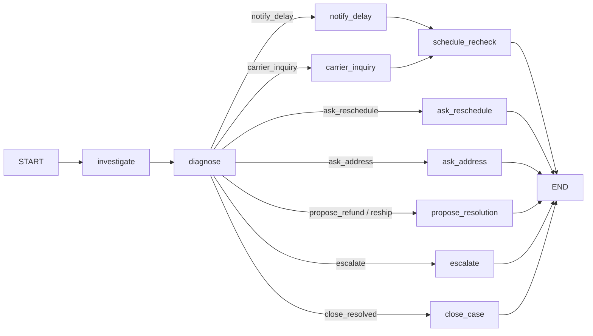

# DeliveryFix
DeliveryFix is an AI agent that catches delivery problems before customers do. It monitors shipments, investigates delays and failed deliveries via carrier APIs, notifies customers, and rebooks or escalates automatically. Built with LangChain, LangGraph and LangSmith, it handles routine cases end to end and asks staff to approve refunds.

## Roadmap

| Phase | Scope | Status |
|---|---|---|
| 0 | Tracking layer: normalized carrier statuses, mock carriers | Mock done (inside Phase 1) |
| 1 | LangChain layer: tools, schemas, policy RAG, guardrails, LLM chains | Done |
| 2 | Core LangGraph flow: investigate → diagnose → route → act, checkpointing | Done |
| 3 | Waits and humans: customer-reply webhooks, `interrupt()` approvals, timeouts | Planned |
| 4 | Detection and scale: rule-based scanner, case dedupe, retries, rate limits | Planned |
| 5 | LangSmith: tracing, evaluation dataset, monitoring | Planned |

## Layout

```
shipment_agent/
  schemas.py        Pydantic models: tracking, orders, Diagnosis, CustomerReplyParse
  config.py         Hard limits (refund caps, confidence threshold), enforced in code
  scenarios.py      8 seed shipments, one per exception type, with expected diagnoses
  carriers/
    base.py         CarrierAdapter interface (swap in Shiprocket/AfterShip later)
    status_map.py   Raw carrier status -> NormalizedStatus; logs unmapped codes
    mock.py         Mock Delhivery / Blue Dart with capabilities and simulated failures
  stores.py         Order store (PII masked for the LLM), case history, refunds/reships/tickets
  messaging.py      Approved templates only, idempotent per case
  policy/
    policies.md     Company policy, one section per chunk with metadata
    retriever.py    BM25 retriever with carrier/topic filters
  tools.py          ReadTools (LLM-callable) and ActionTools (graph nodes only)
  guardrails.py     Deterministic overrides applied to every Diagnosis
  prompts.py        Investigator, diagnoser and reply-parser prompts
  chains.py         Investigation tool loop, diagnoser, reply parser
  graph/
    state.py        CaseState: one thread per shipment, append-only actions/log
    brain.py        LLMBrain (real chains) and ScriptedBrain (deterministic, no API key)
    nodes.py        investigate, diagnose (+ guardrails), action nodes, router
    topology.py     The graph's shape, defined once
    build.py        Compiles the LangGraph StateGraph with a checkpointer
    simulate.py     Same topology in plain Python (tests, no-LangGraph environments)
tests/
demo.py             Runs the read tools on all scenarios; --llm adds diagnosis
run_graph.py        Runs every scenario through the case graph
```

## The case graph (Phase 2)



- **One thread per shipment** (`thread_id = shipment:<AWB>`), so a recheck
  re-enters the same case with its history, recheck count and earlier actions.
- **Rechecks** are re-invocations of the thread with `trigger="recheck"`. After
  `max_rechecks` (3) without resolution, the case escalates instead of sending
  more messages.
- **Run statuses**: `monitoring`, `waiting_customer`, `awaiting_approval`,
  `escalated`, `closed`. The waiting statuses are where Phase 3 adds
  `interrupt()` and customer-reply resumption.
- **Nothing moves money yet.** `propose_resolution` records a refund or
  reship proposal with the approver level (agent, or manager above ₹5,000);
  execution comes with the approval step in Phase 3.
- **Guardrails run inside `diagnose`**, and both the raw LLM diagnosis and the
  final one are kept in state for evaluation.

## Key decisions

- **Read vs action tools.** Only the five read tools are wrapped as LangChain tools.
  Messages, rebooking, address changes, refunds and reships are called by graph
  nodes after routing, so the model cannot trigger them.
- **Guardrails have the final say.** Low confidence or `unclear` escalates;
  orders above ₹25,000 only get automated delay notices; `lost` requires a
  carrier inquiry before any refund and at least 7 days without a scan; no
  refunds on COD orders.
- **Money needs a named approver.** `issue_refund` and `create_reshipment`
  raise `ApprovalRequired` without `approved_by`.
- **Customers only get templates.** Unknown templates and missing variables are
  rejected; each template is sent at most once per case.
- **PII stays out of prompts.** The LLM sees `customer_ref` and a masked phone;
  only the messaging gateway resolves real contact details.

## Run

```bash
pip install -r requirements.txt
pytest -q
python demo.py                 # no LLM needed
export ANTHROPIC_API_KEY=...
python demo.py --llm           # investigator + diagnoser + guardrails, prints accuracy
python run_graph.py            # all scenarios through the graph, scripted diagnoses
python run_graph.py --llm      # same with the real LLM
```

For cases that survive restarts, pass a persistent checkpointer to
`build_graph(...)`, e.g. `SqliteSaver` from `langgraph-checkpoint-sqlite`.

Set `SHIPMENT_AGENT_MODEL` to change the model. Any LangChain chat model that
supports `bind_tools` and `with_structured_output` works: pass it in place of `get_llm()`.
